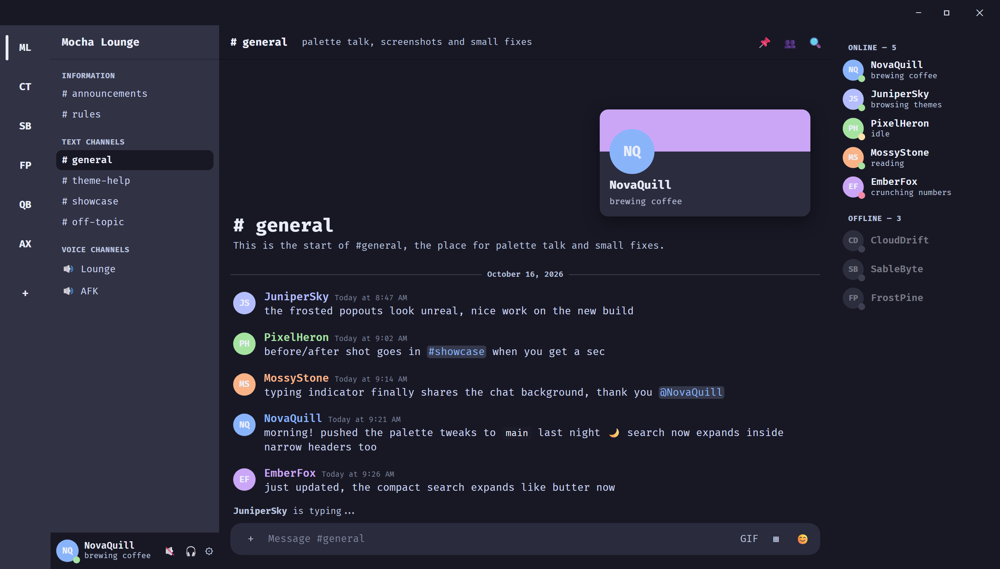

# MochaCord

A Catppuccin Mocha theme for TestCord, built on Midnight. It is one CSS file.

## Install

1. Download `MochaCord.css` from the [latest release](https://github.com/DavidHiFi/MochaCord/releases/latest).
2. Copy it into `%APPDATA%\TestCord\themes`.
3. Turn it on in TestCord under Settings, then Themes.

To update, replace the old file and turn the theme off and on again. TestCord keeps a loaded theme cached, so restart the client if the change does not show.

## What it changes

- Catppuccin Mocha colors on Midnight's layout.
- Rounded panels, and a chat bar that lines up with the user panel.
- Menus, tooltips, and popouts get a frosted background. The blur sits behind the panel, so the text on top stays sharp.
- Fixes for the quest bars and the profile modal tab bar.

## Notes

- The font is FiraCode Nerd Font. It is read from your Windows install, so install it first. Without it, Discord falls back to Fira Code or monospace.
- Midnight's Figtree font loads from Google Fonts, as it does in Midnight.
- Three small snippets load from other authors' repos when the client starts: a compact search button, a page switcher for search results, and bubble usernames. If one of those files changes, the theme changes with it.
- For a frosted window background on Windows, set TestCord's window material to `acrylic` in its settings.
- Built and tested in TestCord only.

## Contributing

Bug reports, ideas, and pull requests are welcome. See [CONTRIBUTING.md](CONTRIBUTING.md) for setup and what to include.

## Star history

Thanks for the stars, screenshots, and fixes.

<a href="https://www.star-history.com/?repos=DavidHiFi%2FMochaCord&amp;type=date">
  <picture>
    <source media="(prefers-color-scheme: dark)" srcset="https://api.star-history.com/chart?repos=DavidHiFi/MochaCord&amp;type=date&amp;theme=dark&amp;legend=top-left" />
    <source media="(prefers-color-scheme: light)" srcset="https://api.star-history.com/chart?repos=DavidHiFi/MochaCord&amp;type=date" />
    
  </picture>
</a>

## Credits

- [Midnight](https://github.com/refact0r/midnight-discord) by refact0r, the base this theme is built on. Its MIT notice is kept at the top of its section in `MochaCord.css`.
- [Catppuccin](https://github.com/catppuccin/catppuccin) for the Mocha palette.
- Theme by david_hifi.

## License

MIT. See [LICENSE](LICENSE).
